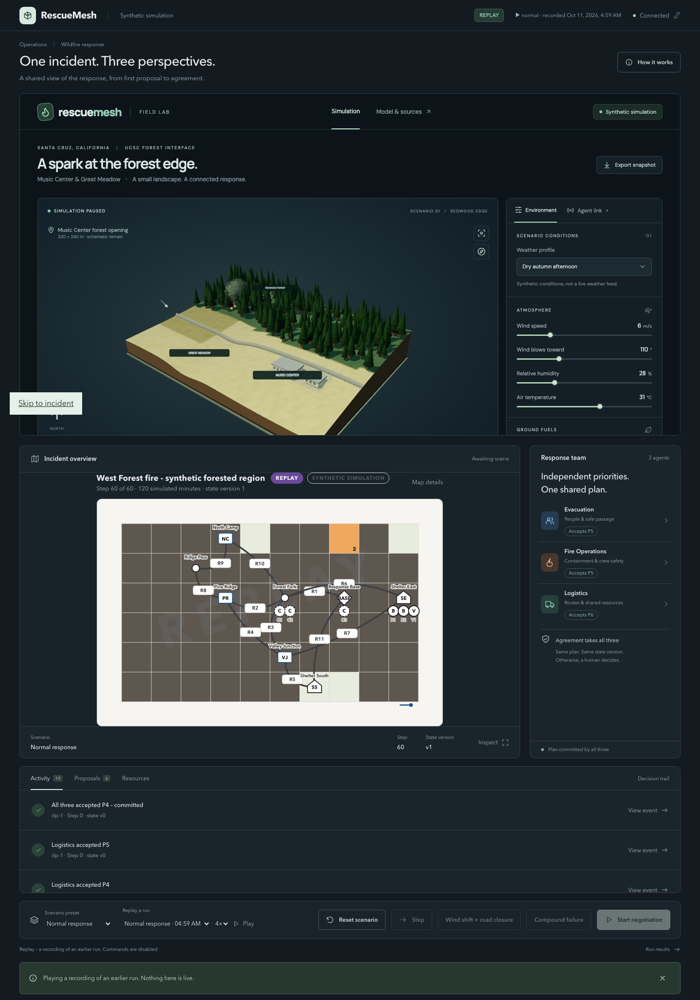

# Benchmark results, what they show, and how to finish them

Everything here is a **synthetic simulation** (AGENTS.md invariant 9). Numbers come only from the simulator's
realized metrics; no row is estimated or filled in.

## Headline (2026-10-11)

Three independent agents, holding different private evidence and competing for the same two resources, negotiate
through up to four rounds and commit only when all three accept the identical plan and the simulator confirms it
on the true world. Before the fixes on PR #54 no live run had ever delivered a plan. After them:

| `normal` preset, 3 seeds (claude-sonnet-5-5) | commits / decision points | mean assisted completion | mean civilian exposure (lower is better) |
|---|---|---|---|
| fixed_rule (deterministic baseline) | 3/3 | 1.00 | 813 |
| single_agent (one model, all evidence) | 3/3 | 0.88 | 713 |
| **rescuemesh (three negotiating agents)** | **3/3** | 0.91 | **687** |

Full tables: [`results.md`](results.md) (rendered from `runs/results.csv`). Coverage is **19 of 36** rows: all 12
`fixed_rule` rows, 4 `single_agent`, 3 `rescuemesh`. The remaining 17 model rows were not run because the Anthropic
credit balance ran out mid-batch, not because they failed. The paired comparison on `wind_shift`, `road_closure` and
`compound_failure` is therefore incomplete and must not be presented as a result.

What a committed negotiation looks like (recorded, replayable, `normal` seed 2):

1. Round 1: three proposals, each serving its author's objective.
2. Round 2: Logistics counter-proposes: *"P1 and P2 route through closed R2 (E-LOG-01). C1 clears R2 first; B1
   takes VJ to SS, B2 takes VJ to SE."* Its private evidence (R2 closed, Shelter South nearly full) is disclosed by
   being cited. Evacuation and Fire Ops counter-propose on top of it.
3. Round 3: the fourth plan is accepted by all three, re-validated on the authoritative world, committed.



## The "before"

`results-2026-10-11-pre-b7-haiku-4-5.csv` is the first full 36-run batch (claude-haiku-4-5). `rescuemesh`: 0
commits / 21 escalations. Its `single_agent` "commits" were F0 fallbacks counted as commits by a since-fixed bug
(`assisted_completion 0.0` on every row). No model produced a valid plan in any of its 24 model runs. The root causes
(our own validation bouncing every open-form plan, a 120k-token cap reached in round 1, locked legs stripped before
validation, and more) are in `docs/handoff/agents__ali-b7-normalize-before-validate.md`.

`results-2026-10-11-partial-haiku-5-5.csv`: 7 rows of a stopped claude-haiku-5-5 batch (its one `rescuemesh` row
escalated; haiku-5-5 commits about one decision point in three on `normal` seed 1).

## Finishing the batch (any Anthropic key)

Only the 17 model rows are missing. On `claude-haiku-5-5` they cost about **$1-2** in total; on
`claude-sonnet-5-5`, which converged every time so far, about **$20-25**. With a funded key in `backend/.env`
(`RESCUEMESH_MODEL`, budgets as in `backend/.env.example`):

```bash
cd backend && uv run uvicorn app.main:app --port 8000 &
# one POST at a time (409 while a batch runs); poll GET /benchmarks/<id> until "done"
curl -s -X POST localhost:8000/benchmarks/run -H 'content-type: application/json' \
  -d '{"presets":["wind_shift"],"seeds":[1],"methods":["rescuemesh"]}'
curl -s -X POST localhost:8000/benchmarks/run -H 'content-type: application/json' \
  -d '{"presets":["wind_shift"],"seeds":[2,3],"methods":["single_agent","rescuemesh"]}'
curl -s -X POST localhost:8000/benchmarks/run -H 'content-type: application/json' \
  -d '{"presets":["road_closure","compound_failure"],"seeds":[1,2,3],"methods":["single_agent","rescuemesh"]}'
uv run python -m app.bench.report ../runs/results.csv ../docs/bench/results.md
```

Discard any model row with zero tokens (a quota or billing failure, invariant 9), then commit `runs/results.csv`
and `docs/bench/results.md`.

## Demo without any key

```bash
cd backend && uv run uvicorn app.main:app --port 8000 &
cd frontend && npm run dev            # open http://127.0.0.1:5173, click "Connect simulator"
```

Pick `Normal response · 04:59 AM` (= `bench-20261011T115655Z-3ff42ddd-normal-s2-rescuemesh`) under "Replay a run",
speed 2 or 4, Play. The recordings live in `runs/fixtures/` (tracked) and replay on any clone; the dashboard shows
the REPLAY label and watermark (PRD §13.3, invariant 8). Seeds 1 and 3 are alternates (seed 3 has four rounds and
four counter-proposals).
